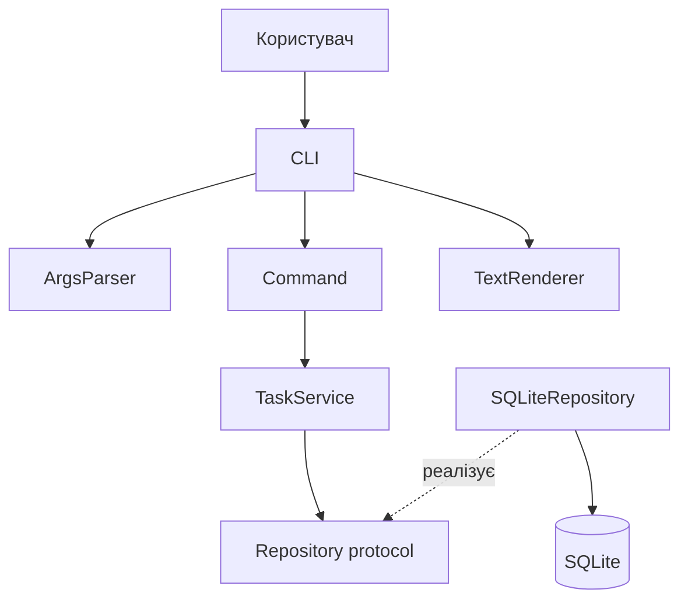
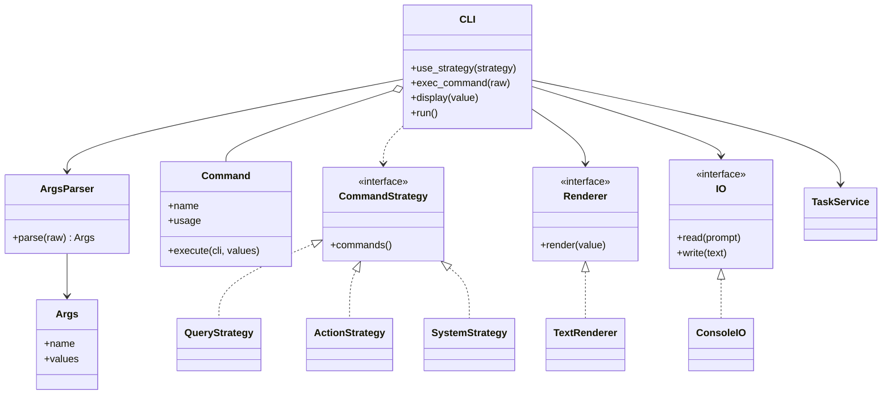

# Дизайн-документ StudyFlow

**Практичне заняття № 13 — Командний інтерфейс додатку**  
**Виконав: Трасковський Богдан**  
Тема 3: власний проєкт. Мова: Python 3.10+.

## 1. Мета та вимоги

StudyFlow — локальний планувальник навчальних завдань. Користувач створює завдання із предметом, назвою та дедлайном, переглядає їх, позначає виконання, змінює дедлайн, видаляє записи й отримує статистику. Дані зберігаються між запусками. На цьому етапі реалізовано саме консольний інтерфейс; інтеграція з Telegram та графічна оболонка не входять до реалізації.

## 2. Архітектура

| Шар | Файли | Відповідальність |
|---|---|---|
| Користувацький інтерфейс | studyflow/cli.py | Парсинг, реєстрація, виконання команд, відображення |
| Бізнес-логіка | studyflow/core.py | Task, TaskService, перевірка даних, фільтрація |
| Постійність | studyflow/data.py | SQLiteRepository, параметризовані SQL-запити |
| Точка входу | main.py | Ініціалізація, аргументи, зв'язування залежностей |

## 3. Користувацький інтерфейс

### 3.1. Режими
- all — усі завдання;
- active — невиконані;
- completed — виконані.

Початковий режим обирається аргументом --mode, під час роботи — командою mode. Режим впливає на списки list, today і week. Статистика показує загальний стан бази.

### 3.2. Класова структура

### 3.3. Шаблони проєктування

**Facade.** CLI надає прості методи для зовнішнього коду. Він координує парсер, реєстр команд і виведення, не виконуючи SQL-запити.

**Strategy.** QueryStrategy, ActionStrategy та SystemStrategy реєструють групи інформаційних, трансформативних і системних команд. Окремий Renderer дозволяє замінювати формат представлення. Реєстрація нової стратегії не потребує змін парсера.

**Command.** Клас Command об'єднує назву, синтаксис і дію. Виконання делегується відповідному об'єкту з реєстру.

**Dependency inversion.** TaskService залежить від протоколу Repository, а CLI — від IO та Renderer. Реальні залежності можна замінити тестовими.

### 3.4. Синтаксис і поведінка

| Команда | Результат |
|---|---|
| help | Список команд |
| add "предмет" "назва" "YYYY-MM-DD HH:MM" | Додати завдання |
| add | Діалог створення |
| list | Усі записи вибраного режиму |
| today | Записи на сьогодні |
| week | Сім календарних днів включно із сьогодні |
| done ID | Позначити виконаним |
| edit ID "YYYY-MM-DD HH:MM" | Змінити дедлайн |
| delete ID | Видалити запис |
| stats | Кількість усіх, виконаних і активних |
| mode all / active / completed | Змінити режим |
| exit | Завершити програму |

ArgsParser використовує shlex для підтримки аргументів у лапках. Неправильні команди, дати та ID обробляються без завершення циклу. Виведення завдань має єдині колонки ID, статус, дедлайн, предмет і назва. Дати локальні. Сортування за дедлайном та ID.

## 4. Дані

Таблиця tasks: id (первинний ключ), subject, title, deadline, completed. SQLiteRepository створює таблицю при старті. Зміни записуються в транзакціях. База локальна й виключена з Git.

## 5. Перевірка

Модульні тести використовують SQLite :memory: або тимчасовий файл та FakeIO. Перевіряються команди, режими, помилки, фільтрація, збереження і розширення реєстру. Запуск: python -m unittest discover -s tests -v. Автоматичний запуск також налаштований у GitHub Actions, якщо доступні runners.

## 6. Подальше розширення

Передбачено додавання графічного або Telegram-інтерфейсу поверх TaskService без перенесення SQL та бізнес-логіки у представлення. Нові команди додаються через CommandStrategy.

## 7. Висновок

Я реалізував командний інтерфейс з окремим парсером, режимами роботи, реєстром команд та стандартизованим виведенням. Розділив представлення, предметну логіку й доступ до даних, щоб спростити підтримку і тестування.
