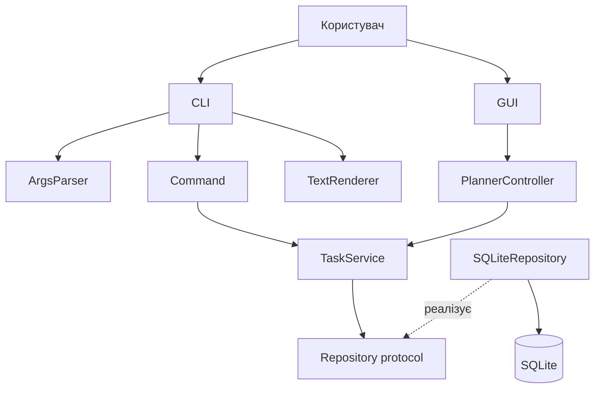
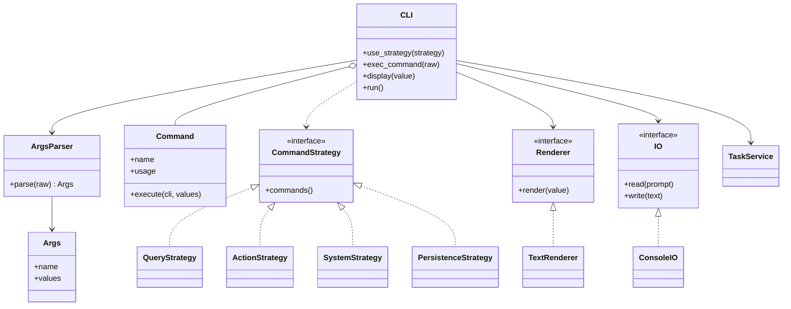
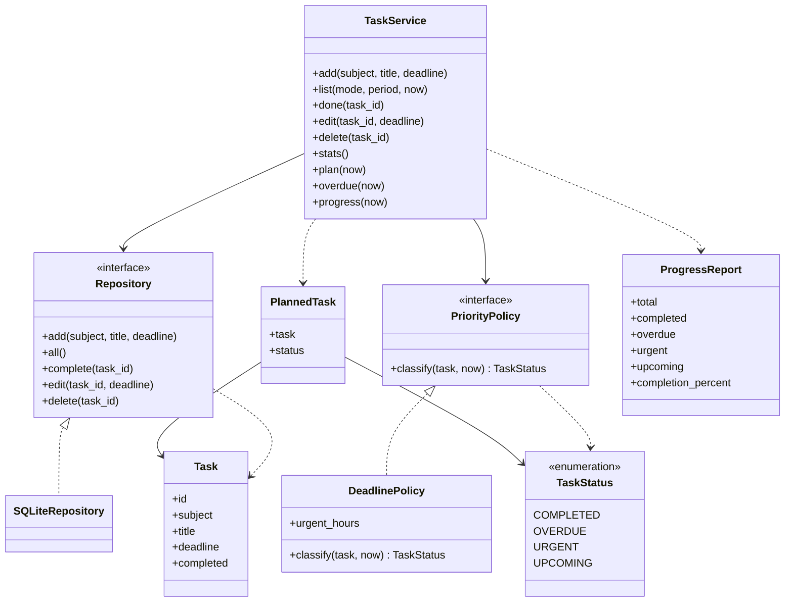
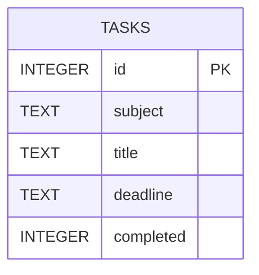
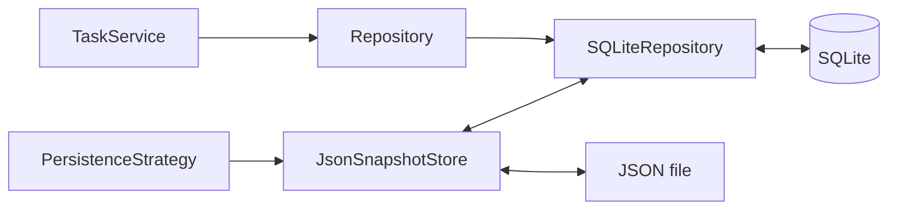
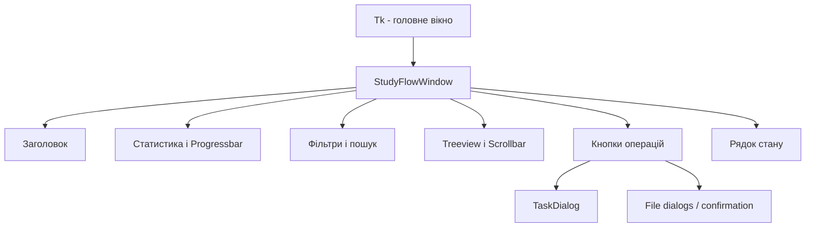
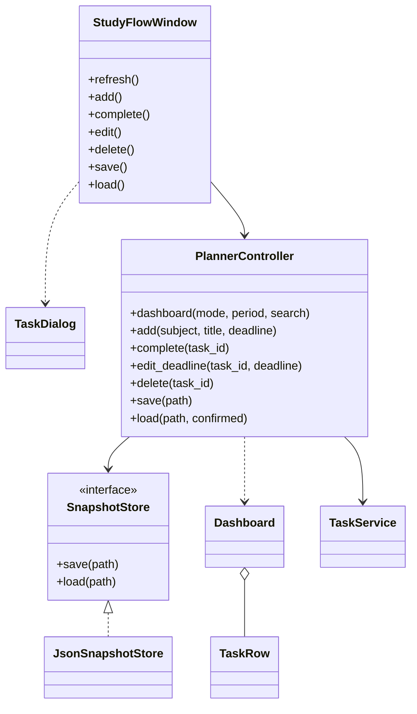

# Дизайн-документ StudyFlow

**Практичні заняття № 13–16 — Командний інтерфейс, бізнес-логіка, постійність інформації та графічний інтерфейс**  
**Виконав: Трасковський Богдан**  
Тема 3: власний проєкт. Мова: Python 3.10+.

## 1. Мета та вимоги

StudyFlow — локальний планувальник навчальних завдань. Користувач створює завдання із предметом, назвою та дедлайном, переглядає їх, позначає виконання, змінює дедлайн, видаляє записи й отримує статистику. Дані зберігаються між запусками. Реалізовано консольний і графічний інтерфейси, бізнес-логіку планування та шар постійності; інтеграція з Telegram не входить до реалізації.

## 2. Архітектура

| Шар | Файли | Відповідальність |
|---|---|---|
| Користувацький інтерфейс | studyflow/cli.py, studyflow/gui.py, studyflow/gui_controller.py | Консольні команди, вікно, події та представлення |
| Бізнес-логіка | studyflow/core.py | Task, TaskService, перевірка даних, фільтрація |
| Постійність | studyflow/data.py, studyflow/persistence.py | SQLiteRepository, JSON-знімки, шляхи користувацьких даних |
| Точка входу | main.py | Ініціалізація, аргументи, зв'язування залежностей |



## 3. Користувацький інтерфейс

### 3.1. Режими
- all — усі завдання;
- active — невиконані;
- completed — виконані.

Початковий режим обирається аргументом --mode, під час роботи — командою mode. Режим впливає на списки list, today і week. Статистика показує загальний стан бази.

### 3.2. Класова структура



### 3.3. Шаблони проєктування

**Facade.** CLI надає прості методи для зовнішнього коду. Він координує парсер, реєстр команд і виведення, не виконуючи SQL-запити.

**Strategy.** QueryStrategy, ActionStrategy та SystemStrategy реєструють групи інформаційних, трансформативних і системних команд. Окремий Renderer дозволяє замінювати формат представлення. Реєстрація нової стратегії не потребує змін парсера.

**Command.** Клас Command об'єднує назву, синтаксис і дію. Виконання делегується відповідному об'єкту з реєстру.

**Dependency inversion.** TaskService залежить від протоколу Repository, а CLI — від IO та Renderer. Реальні залежності можна замінити тестовими.

### 3.4. Синтаксис і поведінка

| Команда | Результат |
|---|---|
| help | Список команд |
| add "предмет" "назва" "YYYY-MM-DD HH:MM" | Додати завдання |
| add | Діалог створення |
| list | Усі записи вибраного режиму |
| today | Записи на сьогодні |
| week | Сім календарних днів включно із сьогодні |
| done ID | Позначити виконаним |
| edit ID "YYYY-MM-DD HH:MM" | Змінити дедлайн |
| delete ID | Видалити запис |
| stats | Кількість усіх, виконаних і активних |
| plan | Активні завдання за пріоритетом |
| overdue | Прострочені невиконані завдання |
| progress | Розподіл завдань за статусами і відсоток виконання |
| mode all / active / completed | Змінити режим |
| save "шлях.json" | Зберегти резервний знімок завдань |
| load "шлях.json" --replace | Відновити знімок із заміною поточних даних |
| exit | Завершити програму |

ArgsParser використовує shlex для підтримки аргументів у лапках. Неправильні команди, дати та ID обробляються без завершення циклу. Виведення завдань має єдині колонки ID, статус, дедлайн, предмет і назва. Дати локальні. Сортування за дедлайном та ID.

## 4. Бізнес-логіка (CORE) — практичне заняття № 14

### 4.1. Предметна модель

Для власної теми StudyFlow ядро реалізує правила планування навчальних завдань, а не механіку текстової гри або парсинг каталогу персонажів. Ядро не імпортує консоль, SQLite, Telegram чи графічні бібліотеки.

| Клас | Призначення |
|---|---|
| Task | Незмінна модель навчального завдання: ID, предмет, назва, дедлайн, ознака виконання |
| TaskService | Фасад сценаріїв роботи: створення, фільтрування, завершення, редагування, видалення, план і прогрес |
| TaskStatus | Перелік станів: виконано, прострочено, терміново, заплановано |
| PriorityPolicy | Контракт стратегії визначення терміновості |
| DeadlinePolicy | Стандартна стратегія з порогом 24 години |
| PlannedTask | Незмінний результат оцінки одного завдання |
| ProgressReport | Незмінна модель підсумкових показників |
| Repository | Контракт доступу до даних, незалежний від конкретного сховища |



### 4.2. Правила та формули

Нехай D — дедлайн, t — поточний локальний час, H — поріг терміновості (за замовчуванням 24 години).

Залишок часу у годинах: r = (D − t).total_seconds() / 3600.

Статус визначається послідовно:

1. Якщо completed = true, завдання виконано незалежно від дедлайну.
2. Якщо r < 0, невиконане завдання прострочено.
3. Якщо 0 ≤ r ≤ H, завдання термінове.
4. Якщо r > H, завдання заплановане.

У момент самого дедлайну завдання ще термінове, а не прострочене. Поріг H має бути додатним. Після редагування дедлайну статус обчислюється заново. Статус терміновості не зберігається окремо, тому не може застаріти у базі.

План містить лише невиконані завдання. Ключ сортування: (ранг статусу, дедлайн, ID), де ранг простроченого = 0, термінового = 1, запланованого = 2. ID розв'язує рівність дедлайнів.

N — загальна кількість, C — виконані, O — прострочені, U — термінові, F — заплановані. Для стандартної політики N = C + O + U + F. Активні = N − C. Прогрес P = 100 × C / N при N > 0; якщо N = 0, P = 0. Результат округлюється до одного десяткового знака.

Наприклад, при t = 01.12.2026 12:00, дедлайн 30.11.2026 12:00 прострочений, 02.12.2026 12:00 терміновий, 03.12.2026 12:00 запланований. Якщо з чотирьох завдань виконано одне, прогрес становить 25%.

### 4.3. Сценарії та інваріанти

- Предмет і назва після видалення зайвих пробілів не можуть бути порожніми.
- Дата повинна бути реальною календарною датою та приводиться до формату YYYY-MM-DD HH:MM.
- Дедлайн у минулому дозволений: це підтримує облік прострочених завдань.
- Неіснуючий ID при завершенні, редагуванні чи видаленні спричиняє ValueError.
- Повторне завершення наявного завдання не змінює його стан.
- Період today охоплює поточну календарну дату; week — сьогодні та шість наступних днів.
- Команди plan, overdue, progress використовують глобальні дані, незалежно від режиму списку CLI.

### 4.4. Патерни та інтеграція

Strategy: TaskService отримує PriorityPolicy через конструктор. Правило терміновості можна замінити, не змінюючи CLI та сховище. Repository і Dependency Injection ізолюють збереження даних. TaskService виступає фасадом предметних операцій. Незмінні dataclass-моделі перешкоджають випадковій зміні стану з боку представлення.

Функція clock передається як залежність; за замовчуванням datetime.now. Це дає відтворювані тести меж 0 та 24 години. CLI лише викликає методи ядра та форматує повернені моделі; майбутній GUI зможе працювати з тими самими моделями.

### 4.5. Тестування бізнес-компоненти

15 нових тестів у tests/test_business_logic.py: прострочення, точний дедлайн, межа 24 годин, сортування, виключення виконаних, порожня статистика, розподіл статусів, редагування, заміна стратегії, валідація, видалення, підміна часу та інтеграція зі SQLite. Для перевірок ядра використано MemoryRepository, який не залежить від консолі та файлової системи. Попередні 13 тестів практичної № 13 залишені без змін.

## 5. Постійність інформації (DATA) — практичне заняття № 15

### 5.1. Вибір механізму збереження

Для власної теми StudyFlow постійність означає збереження створених користувачем навчальних завдань, їхніх дедлайнів та ознак виконання після завершення процесу. Основне сховище — реляційна база SQLite. Додатково реалізовано серіалізацію і десеріалізацію резервних знімків у JSON (UTF-8). Обидва механізми входять до стандартної бібліотеки Python; окремий сервер бази або ORM-фреймворк не потрібен.

### 5.2. Схема бази даних



| Поле | Тип SQLite | Значення |
|---|---|---|
| id | INTEGER PRIMARY KEY AUTOINCREMENT | Унікальний ідентифікатор |
| subject | TEXT NOT NULL | Навчальний предмет |
| title | TEXT NOT NULL | Назва завдання |
| deadline | TEXT NOT NULL | Локальний час YYYY-MM-DD HH:MM |
| completed | INTEGER NOT NULL DEFAULT 0 | 0 — активне, 1 — виконане |

Індекс idx_tasks_deadline додається без видалення попередніх даних. Мапінг виконується вручну: рядки таблиці перетворюються на незмінні об'єкти Task, а логічне поле completed — на 0 або 1. Це простий Data Mapper, а не повноцінний ORM. Запити використовують параметри ?, що відділяють дані від SQL-коду. Кожна зміна фіксується транзакцією. Якщо відновлення знімка зазнає помилки SQL, транзакція відкочується.

### 5.3. Розташування файлів

- Windows: %LOCALAPPDATA%/StudyFlow/studyflow.db (резервний шлях — AppData/Local у домашньому каталозі).
- Linux та інші POSIX-системи: $XDG_DATA_HOME/studyflow/studyflow.db або ~/.local/share/studyflow/studyflow.db.
- Якщо в поточній директорії вже існує studyflow.db попередньої версії, використовується саме він. Це дозволяє продовжити роботу без втрати старих записів.
- Аргумент --db PATH має пріоритет над автоматичним шляхом. Батьківські каталоги створюються за потреби.
- Резервний JSON записується за шляхом, зазначеним користувачем. Для локальних копій рекомендовано каталог backups або суфікс .snapshot.json; вони виключені з Git разом із базами даних.

### 5.4. Серіалізація та десеріалізація



Приклад формату резервної копії:

```json
{
  "version": 1,
  "tasks": [
    {
      "id": 1,
      "subject": "Інформатика",
      "title": "Практична 15",
      "deadline": "2026-12-05 18:00",
      "completed": false
    }
  ]
}
```

Команда save зчитує завдання з репозиторію, перетворює об'єкти у словники, серіалізує JSON у тимчасовий файл у тому самому каталозі та замінює цільовий файл через os.replace після запису. Якщо файл уже існує, він замінюється. Команда load спочатку читає та перевіряє весь документ: версію, склад полів, типи, унікальність додатних ID, календарні дати, непорожній текст та логічну ознаку виконання. Лише після цього всі поточні завдання замінюються в одній транзакції SQLite. ID зі знімка зберігаються, лічильник AUTOINCREMENT не скидається. Відновлення порожнього знімка очищує список. Відновлення потребує явного параметра --replace, оскільки замінює поточні записи. Шлях до активної бази та її службових файлів не може бути шляхом знімка.

Пріоритети і прогрес не дублюються у файлі: їх обчислює ядро на основі відновлених полів та поточного часу. Режим CLI є тимчасовим налаштуванням сеансу і не входить до знімка.

### 5.5. Інкапсуляція та інтеграція

Repository відділяє бізнес-логіку від SQLite. JsonSnapshotStore залежить від контракту SnapshotRepository; PersistenceStrategy працює з контрактом SnapshotStore, а не з файлами чи SQL безпосередньо. У main.py зв'язуються конкретні реалізації. Нове сховище можна підключити без зміни механіки планування.

### 5.6. Демонстрація постійності

1. Запустити python main.py --db demo.db.
2. Додати завдання: add "Інформатика" "Практична 15" "2026-12-05 18:00".
3. Виконати save "backups/demo.snapshot.json" та exit.
4. Повторити запуск із тією ж базою; list відобразить раніше створене завдання.
5. Видалити запис командою delete ID, виконати load "backups/demo.snapshot.json" --replace і list. Знімок відновить запис із початковим ID.
6. Перевірити модульні тести командою python -m unittest discover -s tests -v.

### 5.7. Тестування

tests/test_persistence.py містить 13 тестів повторного відкриття БД, циклу збереження/відновлення, UTF-8, порожнього знімка, помилкового JSON, невідомої версії, неправильних даних, повторних ID, типу completed, захисту файлу БД, відкату транзакції, CLI-команд і відсутнього файлу. 28 тестів попередніх практичних збережено. Загалом передбачено 41 тест; результат запуску слід перевіряти в консолі або GitHub Actions.

## 6. Графічний інтерфейс (GUI) — практичне заняття № 16

### 6.1. Технології та запуск

Для власної теми StudyFlow я обрав Tkinter і ttk, стандартні засоби Python для віконних застосунків. Вони підтримують Windows та інші настільні ОС, не потребують вебсервера. Tkinter має бути встановлений разом із Python. Перевірка: python -m tkinter. Документація: https://docs.python.org/3/library/tkinter.html та https://docs.python.org/3/library/tkinter.ttk.html.

Запуск графічного режиму: python main.py --gui. У Windows також можна відкрити START GUI.bat. Консольний режим залишається доступним через python main.py. Обидва режими використовують однаковий TaskService, SQLiteRepository і JsonSnapshotStore та параметр --db.

### 6.2. Структура компонентів



| Елемент | Призначення |
|---|---|
| Tk, Frame, LabelFrame | Головне вікно та групування елементів |
| Treeview, Scrollbar | Прокручуваний список завдань з ID, предметом, назвою, дедлайном і статусом |
| Entry, Combobox | Пошук за предметом або назвою; фільтри статусу та періоду |
| Progressbar, Label | Загальна статистика та відсоток виконання |
| Button | Створення, завершення, редагування дедлайну, видалення, оновлення, вихід |
| TaskDialog | Модальна форма створення завдання |
| simpledialog, messagebox, filedialog | Редагування, підтвердження, повідомлення, вибір JSON-файлів |

Статуси мають текстові позначки та додаткове кольорове виділення. Вікно масштабується; таблиця займає вільний простір. Доступні режими всіх, активних і виконаних завдань; періоди всіх дат, сьогодні й сім днів. Загальна статистика не залежить від поточного фільтра.

### 6.3. Архітектура та обробка подій

Використано спрощений MVC та event-driven підхід, а не повне MVVM. Model: TaskService і предметні моделі з CORE. View: StudyFlowWindow та TaskDialog. Controller: PlannerController, який не імпортує Tkinter або SQLite і надає готові дані через незмінні TaskRow та Dashboard.



Кнопки передають callback-методи, зміна ComboBox та тексту пошуку запускає refresh. Контролер делегує предметні операції ядру; після успішної операції таблиця та прогрес оновлюються. У разі помилки відкривається діалог, цикл подій продовжується. Видалення й заміна даних зі знімка потребують підтвердження. При закритті вікна mainloop завершується, main.py закриває базу в finally. Дані зберігаються автоматично, а резервні копії створюються за вибором користувача.

### 6.4. Сценарій демонстрації

1. Запустити python main.py --gui --db demo.db.
2. Натиснути «Додати», заповнити предмет, назву та дедлайн.
3. Змінити фільтр, знайти завдання через пошук.
4. Обрати рядок, змінити дедлайн, позначити виконання.
5. Перевірити прогрес, зберегти JSON, видалити завдання і відновити копію після підтвердження.
6. Закрити вікно, повторно запустити з тією самою БД і перевірити записи.

### 6.5. Тестування

У tests/test_gui_controller.py додано 10 модульних тестів: створення, статус, пошук, фільтрування, глобальний прогрес, редагування, видалення, валідація, резервне копіювання та підтвердження відновлення. Вони не потребують графічного дисплея. Попередні 41 тест залишаються. Перевірка взаємодії з реальними вікнами здійснюється окремо за сценарієм вище. Результати фактичного запуску необхідно перевіряти окремо.

## 7. Перевірка

Модульні тести використовують SQLite :memory: або тимчасовий файл та FakeIO. Перевіряються команди, режими, помилки, фільтрація, збереження і розширення реєстру. Запуск: python -m unittest discover -s tests -v. Автоматичний запуск також налаштований у GitHub Actions, якщо доступні runners.

## 8. Подальше розширення

Передбачено подальше розширення графічного інтерфейсу або додавання Telegram-інтерфейсу поверх TaskService без перенесення SQL та бізнес-логіки у представлення. Нові команди додаються через CommandStrategy.

## 9. Висновок

Я реалізував командний інтерфейс з окремим парсером, режимами роботи, реєстром команд та стандартизованим виведенням. Розділив представлення, предметну логіку й доступ до даних, щоб спростити підтримку і тестування. У практичній № 14 я доповнив ядро правилами терміновості, пріоритезацією, розрахунком прогресу та окремими тестами бізнес-логіки. У практичній № 15 я забезпечив збереження даних між запусками, резервне копіювання та відновлення JSON-знімків з перевіркою даних і транзакційним записом.
