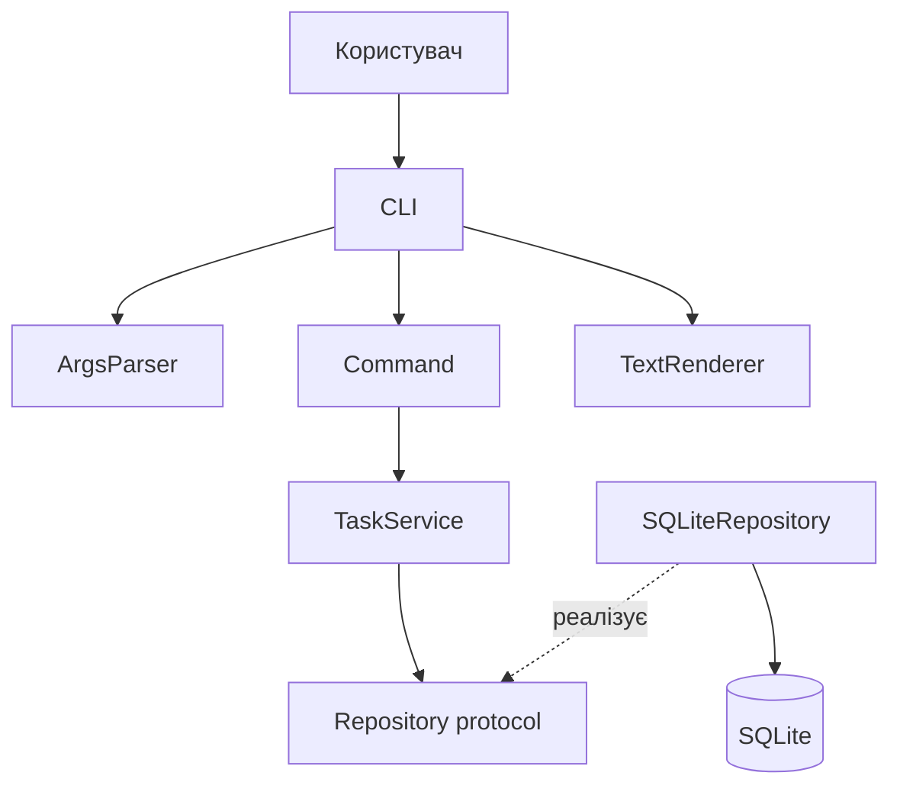
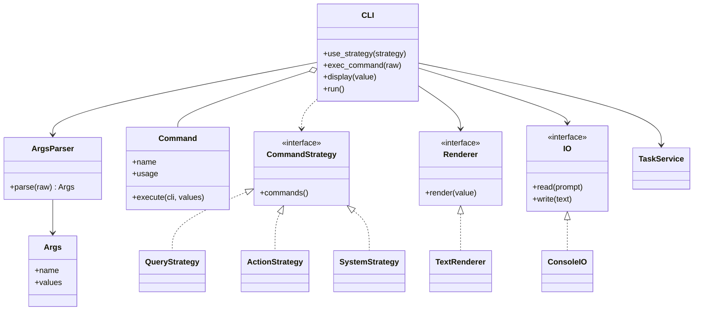
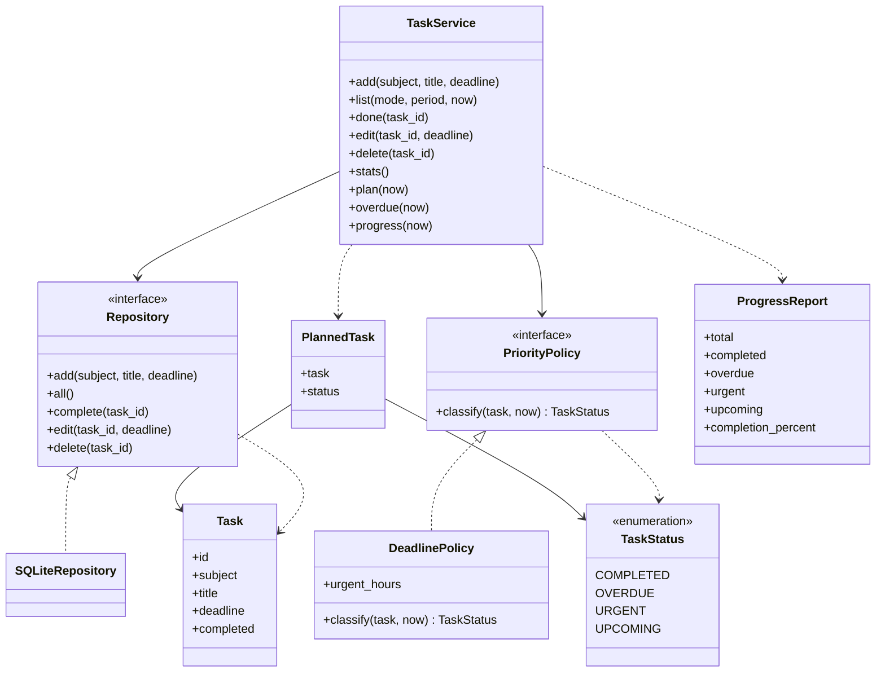

# Дизайн-документ StudyFlow

**Практичні заняття № 13–14 — Командний інтерфейс та бізнес-логіка додатку**  
**Виконав: Трасковський Богдан**  
Тема 3: власний проєкт. Мова: Python 3.10+.

## 1. Мета та вимоги

StudyFlow — локальний планувальник навчальних завдань. Користувач створює завдання із предметом, назвою та дедлайном, переглядає їх, позначає виконання, змінює дедлайн, видаляє записи й отримує статистику. Дані зберігаються між запусками. На цьому етапі реалізовано консольний інтерфейс та бізнес-логіку планування; інтеграція з Telegram та графічна оболонка не входять до реалізації.

## 2. Архітектура

| Шар | Файли | Відповідальність |
|---|---|---|
| Користувацький інтерфейс | studyflow/cli.py | Парсинг, реєстрація, виконання команд, відображення |
| Бізнес-логіка | studyflow/core.py | Task, TaskService, перевірка даних, фільтрація |
| Постійність | studyflow/data.py | SQLiteRepository, параметризовані SQL-запити |
| Точка входу | main.py | Ініціалізація, аргументи, зв'язування залежностей |

## 3. Користувацький інтерфейс

### 3.1. Режими
- all — усі завдання;
- active — невиконані;
- completed — виконані.

Початковий режим обирається аргументом --mode, під час роботи — командою mode. Режим впливає на списки list, today і week. Статистика показує загальний стан бази.

### 3.2. Класова структура

### 3.3. Шаблони проєктування

**Facade.** CLI надає прості методи для зовнішнього коду. Він координує парсер, реєстр команд і виведення, не виконуючи SQL-запити.

**Strategy.** QueryStrategy, ActionStrategy та SystemStrategy реєструють групи інформаційних, трансформативних і системних команд. Окремий Renderer дозволяє замінювати формат представлення. Реєстрація нової стратегії не потребує змін парсера.

**Command.** Клас Command об'єднує назву, синтаксис і дію. Виконання делегується відповідному об'єкту з реєстру.

**Dependency inversion.** TaskService залежить від протоколу Repository, а CLI — від IO та Renderer. Реальні залежності можна замінити тестовими.

### 3.4. Синтаксис і поведінка

| Команда | Результат |
|---|---|
| help | Список команд |
| add "предмет" "назва" "YYYY-MM-DD HH:MM" | Додати завдання |
| add | Діалог створення |
| list | Усі записи вибраного режиму |
| today | Записи на сьогодні |
| week | Сім календарних днів включно із сьогодні |
| done ID | Позначити виконаним |
| edit ID "YYYY-MM-DD HH:MM" | Змінити дедлайн |
| delete ID | Видалити запис |
| stats | Кількість усіх, виконаних і активних |
| plan | Активні завдання за пріоритетом |
| overdue | Прострочені невиконані завдання |
| progress | Розподіл завдань за статусами і відсоток виконання |
| mode all / active / completed | Змінити режим |
| exit | Завершити програму |

ArgsParser використовує shlex для підтримки аргументів у лапках. Неправильні команди, дати та ID обробляються без завершення циклу. Виведення завдань має єдині колонки ID, статус, дедлайн, предмет і назва. Дати локальні. Сортування за дедлайном та ID.

## 4. Бізнес-логіка (CORE) — практичне заняття № 14

### 4.1. Предметна модель

Для власної теми StudyFlow ядро реалізує правила планування навчальних завдань, а не механіку текстової гри або парсинг каталогу персонажів. Ядро не імпортує консоль, SQLite, Telegram чи графічні бібліотеки.

| Клас | Призначення |
|---|---|
| Task | Незмінна модель навчального завдання: ID, предмет, назва, дедлайн, ознака виконання |
| TaskService | Фасад сценаріїв роботи: створення, фільтрування, завершення, редагування, видалення, план і прогрес |
| TaskStatus | Перелік станів: виконано, прострочено, терміново, заплановано |
| PriorityPolicy | Контракт стратегії визначення терміновості |
| DeadlinePolicy | Стандартна стратегія з порогом 24 години |
| PlannedTask | Незмінний результат оцінки одного завдання |
| ProgressReport | Незмінна модель підсумкових показників |
| Repository | Контракт доступу до даних, незалежний від конкретного сховища |

### 4.2. Правила та формули

Нехай D — дедлайн, t — поточний локальний час, H — поріг терміновості (за замовчуванням 24 години).

Залишок часу у годинах: r = (D − t).total_seconds() / 3600.

Статус визначається послідовно:

1. Якщо completed = true, завдання виконано незалежно від дедлайну.
2. Якщо r < 0, невиконане завдання прострочено.
3. Якщо 0 ≤ r ≤ H, завдання термінове.
4. Якщо r > H, завдання заплановане.

У момент самого дедлайну завдання ще термінове, а не прострочене. Поріг H має бути додатним. Після редагування дедлайну статус обчислюється заново. Статус терміновості не зберігається окремо, тому не може застаріти у базі.

План містить лише невиконані завдання. Ключ сортування: (ранг статусу, дедлайн, ID), де ранг простроченого = 0, термінового = 1, запланованого = 2. ID розв'язує рівність дедлайнів.

N — загальна кількість, C — виконані, O — прострочені, U — термінові, F — заплановані. Для стандартної політики N = C + O + U + F. Активні = N − C. Прогрес P = 100 × C / N при N > 0; якщо N = 0, P = 0. Результат округлюється до одного десяткового знака.

Наприклад, при t = 01.12.2026 12:00, дедлайн 30.11.2026 12:00 прострочений, 02.12.2026 12:00 терміновий, 03.12.2026 12:00 запланований. Якщо з чотирьох завдань виконано одне, прогрес становить 25%.

### 4.3. Сценарії та інваріанти

- Предмет і назва після видалення зайвих пробілів не можуть бути порожніми.
- Дата повинна бути реальною календарною датою та приводиться до формату YYYY-MM-DD HH:MM.
- Дедлайн у минулому дозволений: це підтримує облік прострочених завдань.
- Неіснуючий ID при завершенні, редагуванні чи видаленні спричиняє ValueError.
- Повторне завершення наявного завдання не змінює його стан.
- Період today охоплює поточну календарну дату; week — сьогодні та шість наступних днів.
- Команди plan, overdue, progress використовують глобальні дані, незалежно від режиму списку CLI.

### 4.4. Патерни та інтеграція

Strategy: TaskService отримує PriorityPolicy через конструктор. Правило терміновості можна замінити, не змінюючи CLI та сховище. Repository і Dependency Injection ізолюють збереження даних. TaskService виступає фасадом предметних операцій. Незмінні dataclass-моделі перешкоджають випадковій зміні стану з боку представлення.

Функція clock передається як залежність; за замовчуванням datetime.now. Це дає відтворювані тести меж 0 та 24 години. CLI лише викликає методи ядра та форматує повернені моделі; майбутній GUI зможе працювати з тими самими моделями.

### 4.5. Тестування бізнес-компоненти

15 нових тестів у tests/test_business_logic.py: прострочення, точний дедлайн, межа 24 годин, сортування, виключення виконаних, порожня статистика, розподіл статусів, редагування, заміна стратегії, валідація, видалення, підміна часу та інтеграція зі SQLite. Для перевірок ядра використано MemoryRepository, який не залежить від консолі та файлової системи. Попередні 13 тестів практичної № 13 залишені без змін.

## 5. Дані

Таблиця tasks: id (первинний ключ), subject, title, deadline, completed. SQLiteRepository створює таблицю при старті. Зміни записуються в транзакціях. База локальна й виключена з Git.

## 6. Перевірка

Модульні тести використовують SQLite :memory: або тимчасовий файл та FakeIO. Перевіряються команди, режими, помилки, фільтрація, збереження і розширення реєстру. Запуск: python -m unittest discover -s tests -v. Автоматичний запуск також налаштований у GitHub Actions, якщо доступні runners.

## 7. Подальше розширення

Передбачено додавання графічного або Telegram-інтерфейсу поверх TaskService без перенесення SQL та бізнес-логіки у представлення. Нові команди додаються через CommandStrategy.

## 8. Висновок

Я реалізував командний інтерфейс з окремим парсером, режимами роботи, реєстром команд та стандартизованим виведенням. Розділив представлення, предметну логіку й доступ до даних, щоб спростити підтримку і тестування. У практичній № 14 я доповнив ядро правилами терміновості, пріоритезацією, розрахунком прогресу та окремими тестами бізнес-логіки.
